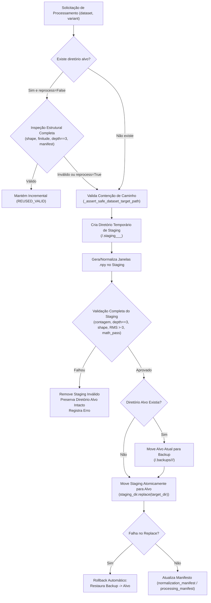

# Plano de Correção e Saneamento de Integridade dos Dados — VibNet-1D (Andromeda)

- **Data de Elaboração:** 18/11/2026
- **Documento Predecessor:** [`docs/experiment_planning/data_integrity_audit_andromeda.md`](file:///home/vfrocha/VibNet-1D/docs/experiment_planning/data_integrity_audit_andromeda.md)
- **Ambiente Alvo:** Máquina `andromeda` (`/home/vfrocha/VibNet-1D`)
- **Status Atual:** **Módulo transacional, scripts e testes unitários implementados e aprovados**; os datasets e manifests reais em `data/` permanecem 100% intocados aguardando autorização separada para execução do saneamento do `HUST`.

---

## 1. Correção do Diagnóstico sobre Atualização dos Manifests

A revisão direta do código-fonte de [`src/preprocessing/normalize_dataset_tl.py`](file:///home/vfrocha/VibNet-1D/src/preprocessing/normalize_dataset_tl.py) e [`scripts/validate_dataset_tl.py`](file:///home/vfrocha/VibNet-1D/scripts/validate_dataset_tl.py) (idêntico a [`src/data/validate_dataset_tl.py`](file:///home/vfrocha/VibNet-1D/src/data/validate_dataset_tl.py)) confirma explicitamente a separação de responsabilidades entre os dois scripts:

### 1.1. Papel de `src/preprocessing/normalize_dataset_tl.py`
- **Único script que cria e atualiza `normalization_manifest.csv`:**
  - A função `write_manifest(rows, output_root, merge_existing=True)` ([linhas 382–437](file:///home/vfrocha/VibNet-1D/src/preprocessing/normalize_dataset_tl.py#L382-L437)) grava `data/processed_tl/<variant>_rms/normalization_manifest.csv`.
  - Como `merge_existing=True` é o padrão, quando executado para um único dataset (`--datasets HUST --variants detrended --use-processed-fallback`), o script lê as linhas existentes de `data/processed_tl/detrended_rms/normalization_manifest.csv`, preserva intocadas as entradas dos outros 8 datasets indexadas por `(dataset, output_variant)` e **atualiza exclusivamente a linha `("HUST", "detrended_rms")`** (corrigindo `input_windows` de `1101` para `951` e mantendo `reference_windows = 150`, `reference_classes = Class_Normal` e `reference_rms = 0.18114055825864453`).

### 1.2. Papel de `scripts/validate_dataset_tl.py` (e `src/data/validate_dataset_tl.py`)
- **Apenas lê `normalization_manifest.csv` (não o modifica):**
  - A função `load_manifest_rms(variant)` ([linhas 201–254](file:///home/vfrocha/VibNet-1D/scripts/validate_dataset_tl.py#L201-L254)) abre `normalization_manifest.csv` somente em modo leitura (`"r"`) para recuperar `reference_rms`, `reference_dataset`, `reference_class` e `reference_windows`.
  - **Portanto, executar `validate_dataset_tl.py` NÃO atualiza `normalization_manifest.csv`.** A correção de `normalization_manifest.csv` exige obrigatoriamente uma nova execução controlada de `src/preprocessing/normalize_dataset_tl.py`.
- **Sobrescreve os 4 relatórios em `data/processed_tl/validation/`:**
  - Nas [linhas 922–962](file:///home/vfrocha/VibNet-1D/scripts/validate_dataset_tl.py#L922-L962), `validate_dataset_tl.py` chama `write_csv()` ([linhas 632–659](file:///home/vfrocha/VibNet-1D/scripts/validate_dataset_tl.py#L632-L659)), que abre em modo `"w"` (sobrescrita total, **sem merge**) os 4 arquivos:
    1. `data/processed_tl/validation/dataset_validation.csv`
    2. `data/processed_tl/validation/file_comparison.csv`
    3. `data/processed_tl/validation/reference_validation.csv`
    4. `data/processed_tl/validation/rms_statistics.csv`
  - **Consequência operacional importante:**
    1. Todos os 4 arquivos existentes em `data/processed_tl/validation/` e o `normalization_manifest.csv` **devem ser copiados para um diretório de backup datado antes de qualquer execução**.
    2. Se `validate_dataset_tl.py` for executado com `--datasets HUST`, os 4 CSVs passarão a conter apenas as linhas de `HUST` (que podem ser salvas separadamente ou seguidas de uma execução de `--datasets cross_dataset` para restaurar a tabela consolidada dos 9 datasets já com `HUST` corrigido).

---

## 2. Lista Exata de Arquivos e Diretórios Envolvidos no Saneamento do `HUST`

### 2.1. Diretórios de Dados Residuais a Serem Removidos Exclusivamente

Nenhum arquivo legítimo de nível 3 (`Load_{0W,200W,400W}/Class_{Normal,41..46}/*.npy`) será tocado. A remoção restringe-se **exclusivamente** aos 6 subdiretórios anômalos de nível 4 (`Class_Normal/Class_40`), que contêm **150 arquivos `.npy` em `data/processed/HUST/`** e **150 arquivos `.npy` em `data/processed_tl/detrended_rms/HUST/`** (total de 300 arquivos redundantes):

1. **Em `data/processed/HUST/` (150 arquivos `.npy`):**
   - `data/processed/HUST/Load_0W/Class_Normal/Class_40/` — **50 arquivos**:
     - `s00008_w00.npy` .. `s00008_w09.npy` (10 arquivos)
     - `s00019_w00.npy` .. `s00019_w09.npy` (10 arquivos)
     - `s00053_w00.npy` .. `s00053_w09.npy` (10 arquivos)
     - `s00068_w00.npy` .. `s00068_w09.npy` (10 arquivos)
     - `s00071_w00.npy` .. `s00071_w09.npy` (10 arquivos)
   - `data/processed/HUST/Load_200W/Class_Normal/Class_40/` — **50 arquivos**:
     - `s00006_w00.npy` .. `s00006_w09.npy` (10 arquivos)
     - `s00025_w00.npy` .. `s00025_w09.npy` (10 arquivos)
     - `s00049_w00.npy` .. `s00049_w09.npy` (10 arquivos)
     - `s00082_w00.npy` .. `s00082_w09.npy` (10 arquivos)
     - `s00097_w00.npy` .. `s00097_w09.npy` (10 arquivos)
   - `data/processed/HUST/Load_400W/Class_Normal/Class_40/` — **50 arquivos**:
     - `s00054_w00.npy` .. `s00054_w09.npy` (10 arquivos)
     - `s00067_w00.npy` .. `s00067_w09.npy` (10 arquivos)
     - `s00076_w00.npy` .. `s00076_w09.npy` (10 arquivos)
     - `s00083_w00.npy` .. `s00083_w09.npy` (10 arquivos)
     - `s00087_w00.npy` .. `s00087_w09.npy` (10 arquivos)

2. **Em `data/processed_tl/detrended_rms/HUST/` (150 arquivos `.npy`):**
   - `data/processed_tl/detrended_rms/HUST/Load_0W/Class_Normal/Class_40/` — **50 arquivos** (`s00008`, `s00019`, `s00053`, `s00068`, `s00071`, `w00..w09`)
   - `data/processed_tl/detrended_rms/HUST/Load_200W/Class_Normal/Class_40/` — **50 arquivos** (`s00006`, `s00025`, `s00049`, `s00082`, `s00097`, `w00..w09`)
   - `data/processed_tl/detrended_rms/HUST/Load_400W/Class_Normal/Class_40/` — **50 arquivos** (`s00054`, `s00067`, `s00076`, `s00083`, `s00087`, `w00..w09`)

### 2.2. Diretórios e Arquivos de Manifesto/Validação Envolvidos

- **Origem de leitura da normalização:** `data/processed/HUST/` (após remoção do resíduo: **951 arquivos `.npy`** em 3 condições e 7 classes).
- **Destino da regeneração da normalização:** `data/processed_tl/detrended_rms/HUST/` (resultado esperado: **951 arquivos `.npy`** em 3 condições e 7 classes).
- **Manifesto atualizado por `normalize_dataset_tl.py`:**
  - `data/processed_tl/detrended_rms/normalization_manifest.csv`
- **Relatórios atualizados por `validate_dataset_tl.py`:**
  - `data/processed_tl/validation/dataset_validation.csv`
  - `data/processed_tl/validation/file_comparison.csv`
  - `data/processed_tl/validation/reference_validation.csv`
  - `data/processed_tl/validation/rms_statistics.csv`
- **Diretório de Backup e Registro de Auditoria (a ser criado antes de qualquer remoção):**
  - `data/backups/remediation_hust_<TIMESTAMP>/`
    - `processed_HUST_Class_40_backup/` (cópia integral preservando estrutura e timestamps dos 150 arquivos de `data/processed/HUST/Load_*W/Class_Normal/Class_40/`)
    - `detrended_rms_HUST_backup/` (cópia integral de `data/processed_tl/detrended_rms/HUST/` antes da remoção e regeneração)
    - `manifests_before/` (cópia de `normalization_manifest.csv` e dos 4 CSVs de `data/processed_tl/validation/`)
    - `removed_files_manifest_sha256.csv` (registro formal dos 300 arquivos removidos com caminho relativo, caminho original equivalente em `Class_Normal/`, tamanho em bytes, `mtime` e hash `SHA-256` pareado).

---

## 3. Procedimento Passo a Passo e Comandos de Execução na Ordem Correta

> [!IMPORTANT]
> Os comandos abaixo compõem o protocolo de execução aprovado e **só devem ser executados quando autorizados**. Todos os blocos shell utilizam `set -euo pipefail` e incluem travas rígidas (`assert`) que:
> 1. Verificam a integridade física e a paridade de hashes SHA-256 de todas as cópias de backup antes de qualquer operação destrutiva;
> 2. Exigem exatamente 300 registros no manifesto `removed_files_manifest_sha256.csv` (150 da variante `processed` e 150 da variante `detrended_rms`);
> 3. Confirmam que 100% dos hashes SHA-256 correspondem tanto ao par canônico em `Class_Normal/` quanto à cópia salva no backup (não permitindo que a mera existência do arquivo CSV autorize a remoção);
> 4. Interrompem imediatamente a execução caso qualquer verificação falhe.

### Etapa 3.1 — Verificação Prévia, Registro de SHA-256 e Backup Completo com Verificação de Integridade

```bash
set -euo pipefail

# 1. Definir timestamp único do lote de saneamento
export REMEDIATION_TS="$(date -u +%Y%m%d_%H%M%S)"
export BACKUP_ROOT="/home/vfrocha/VibNet-1D/data/backups/remediation_hust_${REMEDIATION_TS}"

mkdir -p "${BACKUP_ROOT}/manifests_before"
mkdir -p "${BACKUP_ROOT}/processed_HUST_Class_40_backup"
mkdir -p "${BACKUP_ROOT}/detrended_rms_HUST_backup"

# 2. Preservar normalization_manifest.csv e todos os 4 relatórios de validação existentes
cp -a /home/vfrocha/VibNet-1D/data/processed_tl/detrended_rms/normalization_manifest.csv \
      "${BACKUP_ROOT}/manifests_before/"
cp -a /home/vfrocha/VibNet-1D/data/processed_tl/validation/*.csv \
      "${BACKUP_ROOT}/manifests_before/"

# 3. Backup completo de data/processed_tl/detrended_rms/HUST e das pastas Class_40 de data/processed/HUST
cp -a /home/vfrocha/VibNet-1D/data/processed_tl/detrended_rms/HUST/. \
      "${BACKUP_ROOT}/detrended_rms_HUST_backup/"

for load in Load_0W Load_200W Load_400W; do
  mkdir -p "${BACKUP_ROOT}/processed_HUST_Class_40_backup/${load}/Class_Normal"
  cp -a "/home/vfrocha/VibNet-1D/data/processed/HUST/${load}/Class_Normal/Class_40" \
        "${BACKUP_ROOT}/processed_HUST_Class_40_backup/${load}/Class_Normal/"
done

# 4. Conferir os 150 arquivos em cada variante, validar 100% dos pares SHA-256,
#    verificar a integridade bit-a-bit das cópias de backup e gerar o registro CSV
python3 - << 'EOF'
import csv
import hashlib
import os
from pathlib import Path

backup_root = Path(os.environ["BACKUP_ROOT"])
manifest_out = backup_root / "removed_files_manifest_sha256.csv"

def sha256(p: Path) -> str:
    return hashlib.sha256(p.read_bytes()).hexdigest()

# A. Verificar integridade das cópias de backup dos 5 CSVs de manifesto/validação
expected_manifests = [
    (
        Path("/home/vfrocha/VibNet-1D/data/processed_tl/detrended_rms/normalization_manifest.csv"),
        backup_root / "manifests_before" / "normalization_manifest.csv",
    ),
    (
        Path("/home/vfrocha/VibNet-1D/data/processed_tl/validation/dataset_validation.csv"),
        backup_root / "manifests_before" / "dataset_validation.csv",
    ),
    (
        Path("/home/vfrocha/VibNet-1D/data/processed_tl/validation/file_comparison.csv"),
        backup_root / "manifests_before" / "file_comparison.csv",
    ),
    (
        Path("/home/vfrocha/VibNet-1D/data/processed_tl/validation/reference_validation.csv"),
        backup_root / "manifests_before" / "reference_validation.csv",
    ),
    (
        Path("/home/vfrocha/VibNet-1D/data/processed_tl/validation/rms_statistics.csv"),
        backup_root / "manifests_before" / "rms_statistics.csv",
    ),
]
for src_csv, bkp_csv in expected_manifests:
    assert src_csv.is_file(), f"CSV original ausente: {src_csv}"
    assert bkp_csv.is_file(), f"Backup do CSV ausente: {bkp_csv}"
    assert sha256(src_csv) == sha256(bkp_csv), f"Divergência SHA-256 no backup do CSV: {bkp_csv}"

# B. Verificar integridade bit-a-bit do backup completo de detrended_rms/HUST (1.101 arquivos .npy)
det_rms_root = Path("/home/vfrocha/VibNet-1D/data/processed_tl/detrended_rms/HUST")
det_rms_bkp_root = backup_root / "detrended_rms_HUST_backup"
src_det_files = sorted(det_rms_root.rglob("*.npy"))
bkp_det_files = sorted(det_rms_bkp_root.rglob("*.npy"))
assert len(src_det_files) == 1101, f"Contagem inesperada em detrended_rms/HUST: {len(src_det_files)} != 1101"
assert len(bkp_det_files) == 1101, f"Backup incompleto em detrended_rms_HUST_backup: {len(bkp_det_files)} != 1101"
for src_f in src_det_files:
    rel = src_f.relative_to(det_rms_root)
    bkp_f = det_rms_bkp_root / rel
    assert bkp_f.is_file(), f"Arquivo ausente no backup detrended_rms_HUST_backup: {rel}"
    assert sha256(src_f) == sha256(bkp_f), f"Hash divergente no backup detrended_rms_HUST_backup: {rel}"

# C. Verificar os 150 arquivos Class_40 em cada variante, paridade com Class_Normal e paridade com o backup
variants = [
    (
        "processed",
        Path("/home/vfrocha/VibNet-1D/data/processed/HUST"),
        backup_root / "processed_HUST_Class_40_backup",
    ),
    (
        "detrended_rms",
        Path("/home/vfrocha/VibNet-1D/data/processed_tl/detrended_rms/HUST"),
        backup_root / "detrended_rms_HUST_backup",
    ),
]
loads = ["Load_0W", "Load_200W", "Load_400W"]

rows = []
for var_name, root, var_bkp_root in variants:
    var_files = []
    for load in loads:
        c40_dir = root / load / "Class_Normal" / "Class_40"
        norm_dir = root / load / "Class_Normal"
        bkp_c40_dir = var_bkp_root / load / "Class_Normal" / "Class_40"
        assert c40_dir.is_dir(), f"Diretório esperado ausente: {c40_dir}"
        assert bkp_c40_dir.is_dir(), f"Diretório de backup ausente: {bkp_c40_dir}"
        files = sorted(c40_dir.glob("*.npy"))
        bkp_files = sorted(bkp_c40_dir.glob("*.npy"))
        assert len(files) == 50, f"Contagem inesperada em {c40_dir}: {len(files)} != 50"
        assert len(bkp_files) == 50, f"Contagem inesperada no backup {bkp_c40_dir}: {len(bkp_files)} != 50"
        for f in files:
            counterpart = norm_dir / f.name
            bkp_copy = bkp_c40_dir / f.name
            assert counterpart.is_file(), f"Arquivo par ausente em Class_Normal: {counterpart}"
            assert bkp_copy.is_file(), f"Cópia de backup ausente: {bkp_copy}"
            h_dup = sha256(f)
            h_orig = sha256(counterpart)
            h_bkp = sha256(bkp_copy)
            assert h_dup == h_orig, f"Divergência SHA-256 com Class_Normal em {f}: {h_dup} != {h_orig}"
            assert h_dup == h_bkp, f"Divergência SHA-256 com cópia de backup em {bkp_copy}: {h_dup} != {h_bkp}"
            var_files.append(f)
            rows.append({
                "variant": var_name,
                "load": load,
                "duplicate_rel_path": f.relative_to(root).as_posix(),
                "canonical_rel_path": counterpart.relative_to(root).as_posix(),
                "backup_rel_path": bkp_copy.relative_to(backup_root).as_posix(),
                "size_bytes": f.stat().st_size,
                "mtime_epoch": f.stat().st_mtime,
                "sha256": h_dup,
                "canonical_sha256": h_orig,
                "backup_sha256": h_bkp,
                "sha256_match": True,
            })
    assert len(var_files) == 150, f"Total inesperado para {var_name}: {len(var_files)} != 150"

assert len(rows) == 300, f"Total de registros no manifesto deve ser 300, obtido {len(rows)}"

with manifest_out.open("w", newline="", encoding="utf-8") as fp:
    writer = csv.DictWriter(fp, fieldnames=list(rows[0].keys()))
    writer.writeheader()
    writer.writerows(rows)

print(f"[OK] Backups verificados bit-a-bit (5 CSVs + 1.101 detrended_rms + 150 processed Class_40).")
print(f"[OK] Verificados {len(rows)} arquivos (150 processed + 150 detrended_rms) com 100% de match SHA-256.")
print(f"[OK] Manifesto de remoção salvo em: {manifest_out}")
EOF
```

### Etapa 3.2 — Remoção Exclusiva de `Load_{0W,200W,400W}/Class_Normal/Class_40/` (Condicionada à Validação Integral do Manifesto e dos Backups)

```bash
set -euo pipefail

# Executa a remoção restrita SOMENTE após revalidar o conteúdo integral do CSV (300 linhas,
# 150 por variante, 100% de correspondência SHA-256) e a completude física e criptográfica dos backups.
# A mera existência do arquivo CSV NÃO autoriza a remoção.
python3 - << 'EOF'
import csv
import hashlib
import os
import shutil
from pathlib import Path

backup_root = Path(os.environ["BACKUP_ROOT"]).resolve()
manifest_csv = backup_root / "removed_files_manifest_sha256.csv"
assert manifest_csv.is_file(), f"Manifesto de remoção ausente: {manifest_csv}"

def sha256(p: Path) -> str:
    return hashlib.sha256(p.read_bytes()).hexdigest()

# 1. Trava de verificação dos backups de manifestos (5 CSVs) e de diretórios (1.101 + 150 arquivos .npy)
required_manifest_backups = [
    "normalization_manifest.csv",
    "dataset_validation.csv",
    "file_comparison.csv",
    "reference_validation.csv",
    "rms_statistics.csv",
]
for m_name in required_manifest_backups:
    m_bkp = backup_root / "manifests_before" / m_name
    assert m_bkp.is_file() and m_bkp.stat().st_size > 0, f"Backup de manifesto ausente ou vazio: {m_bkp}"

bkp_det_rms_files = list((backup_root / "detrended_rms_HUST_backup").rglob("*.npy"))
bkp_proc_c40_files = list((backup_root / "processed_HUST_Class_40_backup").rglob("*.npy"))
assert len(bkp_det_rms_files) == 1101, (
    f"Trava acionada: backup detrended_rms_HUST_backup incompleto ({len(bkp_det_rms_files)} != 1101)."
)
assert len(bkp_proc_c40_files) == 150, (
    f"Trava acionada: backup processed_HUST_Class_40_backup incompleto ({len(bkp_proc_c40_files)} != 150)."
)

# 2. Trava de verificação profunda do conteúdo de removed_files_manifest_sha256.csv
with manifest_csv.open("r", newline="", encoding="utf-8") as fp:
    rows = list(csv.DictReader(fp))

assert len(rows) == 300, f"Trava acionada: esperado exatamente 300 registros no CSV, encontrado {len(rows)}."

roots_by_variant = {
    "processed": Path("/home/vfrocha/VibNet-1D/data/processed/HUST").resolve(),
    "detrended_rms": Path("/home/vfrocha/VibNet-1D/data/processed_tl/detrended_rms/HUST").resolve(),
}
counts_by_variant = {"processed": 0, "detrended_rms": 0}
counts_by_var_load = {}

for idx, row in enumerate(rows, start=1):
    var = row.get("variant", "")
    load = row.get("load", "")
    assert var in roots_by_variant, f"Linha {idx}: variante inválida '{var}'."
    assert load in ("Load_0W", "Load_200W", "Load_400W"), f"Linha {idx}: load inválido '{load}'."

    h_dup = row.get("sha256", "")
    h_can = row.get("canonical_sha256", "")
    h_bkp = row.get("backup_sha256", "")
    match_flag = row.get("sha256_match", "")

    assert len(h_dup) == 64 and h_dup == h_can == h_bkp, (
        f"Linha {idx}: hashes SHA-256 inválidos ou divergentes ({h_dup} vs {h_can} vs {h_bkp})."
    )
    assert match_flag == "True", f"Linha {idx}: sha256_match != True ({match_flag})."

    v_root = roots_by_variant[var]
    dup_file = (v_root / row["duplicate_rel_path"]).resolve()
    can_file = (v_root / row["canonical_rel_path"]).resolve()
    bkp_file = (backup_root / row["backup_rel_path"]).resolve()

    assert dup_file.is_file(), f"Linha {idx}: arquivo duplicado alvo não encontrado: {dup_file}"
    assert can_file.is_file(), f"Linha {idx}: arquivo canônico em Class_Normal ausente: {can_file}"
    assert bkp_file.is_file(), f"Linha {idx}: arquivo no diretório de backup ausente: {bkp_file}"

    # Recalcula hashes antes de autorizar exclusão
    assert sha256(dup_file) == h_dup, f"Linha {idx}: hash do arquivo alvo diverge do manifesto: {dup_file}"
    assert sha256(can_file) == h_can, f"Linha {idx}: hash do arquivo canônico diverge do manifesto: {can_file}"
    assert sha256(bkp_file) == h_bkp, f"Linha {idx}: hash do arquivo de backup diverge do manifesto: {bkp_file}"

    counts_by_variant[var] += 1
    counts_by_var_load[(var, load)] = counts_by_var_load.get((var, load), 0) + 1

assert counts_by_variant["processed"] == 150, (
    f"Trava acionada: esperado 150 registros para 'processed', obtido {counts_by_variant['processed']}."
)
assert counts_by_variant["detrended_rms"] == 150, (
    f"Trava acionada: esperado 150 registros para 'detrended_rms', obtido {counts_by_variant['detrended_rms']}."
)
for var in ("processed", "detrended_rms"):
    for load in ("Load_0W", "Load_200W", "Load_400W"):
        c = counts_by_var_load.get((var, load), 0)
        assert c == 50, f"Trava acionada: esperado 50 registros para ({var}, {load}), obtido {c}."

print("[OK] Todas as travas pré-remoção aprovadas (300/300 registros, 150/variante, backups e SHA-256 íntegros).")

# 3. Remoção exclusiva dos 6 subdiretórios Class_Normal/Class_40
loads = ["Load_0W", "Load_200W", "Load_400W"]
for var_name, root in roots_by_variant.items():
    for load in loads:
        c40_dir = (root / load / "Class_Normal" / "Class_40").resolve()
        assert c40_dir.is_relative_to(root), f"Caminho fora da raiz autorizada: {c40_dir}"
        assert c40_dir.name == "Class_40" and c40_dir.parent.name == "Class_Normal"
        shutil.rmtree(c40_dir)
        print(f"[REMOVIDO] {c40_dir}")

    remaining = list(root.rglob("*.npy"))
    bad_depth = [p for p in remaining if len(p.relative_to(root).parts) != 3]
    assert len(remaining) == 951, f"Contagem pós-remoção inesperada em {root}: {len(remaining)} != 951"
    assert len(bad_depth) == 0, f"Arquivos fora do nível 3 ainda presentes: {bad_depth}"
    print(f"[OK] {root}: 951 arquivos .npy íntegros (todos com profundidade 3).")
EOF
```

### Etapa 3.3 — Regeneração Controlada da Normalização (`normalize_dataset_tl.py`)

```bash
set -euo pipefail

# Regenera data/processed_tl/detrended_rms/HUST a partir de data/processed/HUST (951 janelas)
# e atualiza a linha de HUST em data/processed_tl/detrended_rms/normalization_manifest.csv
python3 src/preprocessing/normalize_dataset_tl.py \
  --datasets HUST \
  --variants detrended \
  --use-processed-fallback
```

**O que ocorre nesta execução:**
- **Origem resolvida (`resolve_dataset_input_dir`):** Como `data/processed_tl/detrended/HUST` não existe e `--use-processed-fallback` está ativo, a origem resolvida é `/home/vfrocha/VibNet-1D/data/processed/HUST`.
- **Saída resolvida:** `/home/vfrocha/VibNet-1D/data/processed_tl/detrended_rms/HUST`.
- **Cálculo de $\text{RMS}_{\text{ref}}$:** `discover_normal_class` encontra `Class_Normal` (150 janelas: 50 em `Load_0W`, 50 em `Load_200W`, 50 em `Load_400W`) e calcula `reference_rms = 0.18114055825864453`.
- **Normalização:** Processa em diretório de staging exatamente as `input_windows = 951` janelas (`0` erros), valida a correspondência 1-para-1 dos 951 caminhos relativos e promove atomicamente após backup.
- **Atualização do Manifesto:** `write_manifest(..., merge_existing=True)` atualiza transacionalmente a linha `HUST,detrended_rms` em `data/processed_tl/detrended_rms/normalization_manifest.csv` com `reference_windows = 150` e `input_windows = 951`, preservando as outras 8 linhas do manifesto.

### Etapa 3.4 — Revalidação (`validate_dataset_tl.py`)

```bash
set -euo pipefail

# 1. Executa a validação específica do HUST solicitada no plano
python3 scripts/validate_dataset_tl.py \
  --datasets HUST \
  --variants detrended \
  --use-processed-fallback

# 2. Salva cópia dos relatórios específicos do HUST no diretório de auditoria/backup
mkdir -p "${BACKUP_ROOT}/validation_hust_only"
cp -a /home/vfrocha/VibNet-1D/data/processed_tl/validation/*.csv \
      "${BACKUP_ROOT}/validation_hust_only/"

# 3. Reexecuta para o conjunto cross_dataset (9 datasets) para manter os 4 CSVs em
#    data/processed_tl/validation/ completos para todos os 9 datasets e com o HUST corrigido
python3 scripts/validate_dataset_tl.py \
  --datasets cross_dataset \
  --variants detrended \
  --use-processed-fallback
```

---

## 4. Arquitetura Transacional Implementada (`src/vibnet/data/transactional_io.py`, `prepare_datasets.py` e `normalize_dataset_tl.py`)

Para eliminar definitivamente o risco de acumular arquivos residuais em reprocessamentos ou cópias entre máquinas **sem utilizar `shutil.rmtree()` como limpeza automática incondicional**, foi implementada a arquitetura de **Transação em Staging com Validação Pré-Substituição, Backup e Rollback Automático** centralizada no módulo compartilhado [`src/vibnet/data/transactional_io.py`](file:///home/vfrocha/VibNet-1D/src/vibnet/data/transactional_io.py).

### 4.1. Os Quatro Ajustes Técnicos Obrigatórios Implementados

1. **Comparação Exata dos Caminhos Relativos entre Entrada e Saída (além das contagens):**
   - Em `validate_staged_dataset_dir()` ([`src/vibnet/data/transactional_io.py`](file:///home/vfrocha/VibNet-1D/src/vibnet/data/transactional_io.py)), quando `source_dir` e/ou `expected_relative_paths` são informados, o validador constrói o conjunto de caminhos relativos POSIX (`<condição>/<classe>/<janela.npy>`) da origem e do staging e exige igualdade estrita de conjuntos (`staging_rel_set == source_rel_set`), reportando explicitamente quaisquer arquivos `missing_relative_paths` ou `extra_relative_paths`.
2. **Módulo Compartilhado de Processamento Transacional:**
   - Todas as primitivas transacionais (`assert_no_symlink_components`, `assert_no_symlinks_in_tree`, `assert_same_filesystem`, `assert_safe_dataset_target_path`, `create_staging_dataset_dir`, `cleanup_staging_dir`, `validate_staged_dataset_dir`, `DatasetCommitReceipt`, `commit_staged_dataset_dir`, `ManifestCommitReceipt`, `transactional_update_manifest`, `transactional_write_csv_manifest`, `transactional_write_json_manifest`) foram implementadas em [`src/vibnet/data/transactional_io.py`](file:///home/vfrocha/VibNet-1D/src/vibnet/data/transactional_io.py), exportadas em [`src/vibnet/data/__init__.py`](file:///home/vfrocha/VibNet-1D/src/vibnet/data/__init__.py) e reutilizadas por [`src/preprocessing/normalize_dataset_tl.py`](file:///home/vfrocha/VibNet-1D/src/preprocessing/normalize_dataset_tl.py) e [`scripts/setup/prepare_datasets.py`](file:///home/vfrocha/VibNet-1D/scripts/setup/prepare_datasets.py).
3. **Proteção contra Links Simbólicos e Garantia de Mesmo Filesystem (`st_dev`):**
   - `assert_no_symlink_components()` e `assert_no_symlinks_in_tree()` bloqueiam qualquer link simbólico em diretórios ancestrais, diretórios de saída, subpastas de condição/classe ou arquivos `.npy`.
   - `assert_same_filesystem()` verifica via `os.stat(..., follow_symlinks=False).st_dev` que `staging`, `backup`, `target` e `manifest` residem exatamente na mesma partição/filesystem antes de iniciar a operação, garantindo que `Path.replace()` seja atômico no nível do kernel POSIX.
4. **Atualização Transacional dos Manifests com Backup, Rollback Coordenado e Finalização Diferida (`keep_backup=False`):**
   - `transactional_write_csv_manifest()` (para `normalization_manifest.csv`) e `transactional_write_json_manifest()` (para `processing_manifest.json`) gravam o manifesto atualizado em arquivo temporário irmão (`.staging_<manifest>_<ts>_<pid>.tmp`), forçam `os.fsync()`, validam a estrutura e cabeçalhos/chaves do arquivo em staging, criam backup verificado por SHA-256 em `<backup_root>/<ts>/manifests/` e promovem o arquivo via `Path.replace()`, retornando um `ManifestCommitReceipt`.
   - **Transação lógica única:** Em `prepare_datasets()` ([`scripts/setup/prepare_datasets.py`](file:///home/vfrocha/VibNet-1D/scripts/setup/prepare_datasets.py)), todos os recibos de diretórios (`DatasetCommitReceipt`) e de manifestos (`ManifestCommitReceipt`, incluindo o `normalization_manifest.csv` retornado por `norm_tl.write_manifest(..., return_receipt=True)`) são registrados em uma única fila ordenada (`all_commit_receipts: List[TransactionReceipt]`). Caso qualquer etapa posterior falhe (inclusive a gravação final de `processing_manifest.json`), `rollback_transaction_receipts(all_commit_receipts)` percorre todos os recibos na **ordem estritamente inversa**, restaurando bit a bit tanto `normalization_manifest.csv` quanto todos os diretórios de datasets processados.
   - **Limpeza diferida de backups (`keep_backup=False`):** Nem `commit_staged_dataset_dir()` nem `transactional_update_manifest()` excluem o backup anterior durante o commit individual. Os backups permanecem íntegros em disco até o término de toda a transação lógica, sendo descartados somente quando `finalize_transaction_receipts(all_commit_receipts, keep_backup=keep_backup)` é chamado após o commit final bem-sucedido de todos os diretórios e manifestos.



### 4.2. Detalhamento das Funções a Adicionar/Modificar

#### A. Proteção Estrita contra Caminhos Fora dos Diretórios Autorizados (`_assert_safe_dataset_target_path`)
Aplicada tanto em `src/preprocessing/normalize_dataset_tl.py` quanto em `scripts/setup/prepare_datasets.py`:

```python
def _assert_safe_dataset_target_path(
    target_dir: Path,
    allowed_variant_root: Path,
    dataset_name: str,
    allowed_datasets: Sequence[str],
) -> Path:
    """Garante que target_dir é estritamente <allowed_variant_root>/<dataset_name> dentro da árvore autorizada."""
    if dataset_name not in allowed_datasets:
        raise ValueError(f"Dataset não autorizado: '{dataset_name}'. Permitidos: {list(allowed_datasets)}")
    if "/" in dataset_name or "\\" in dataset_name or ".." in dataset_name or not dataset_name.strip():
        raise ValueError(f"Nome de dataset inválido: '{dataset_name}'")

    resolved_root = allowed_variant_root.expanduser().resolve()
    resolved_target = target_dir.expanduser().resolve()

    if not resolved_target.is_relative_to(resolved_root):
        raise PermissionError(
            f"Violação de contenção de caminho: '{resolved_target}' está fora de '{resolved_root}'."
        )
    if resolved_target == resolved_root or resolved_target.parent != resolved_root:
        raise PermissionError(
            f"O caminho alvo '{resolved_target}' deve ser filho imediato de '{resolved_root}'."
        )
    if resolved_target.name != dataset_name:
        raise PermissionError(
            f"Nome do diretório final ('{resolved_target.name}') difere de '{dataset_name}'."
        )
    return resolved_target
```

#### B. Validação Estrutural e Matemática do Diretório de Staging (`validate_staged_dataset_dir`)
Antes de substituir qualquer diretório existente, o diretório `.staging_<dataset>_<ts>_<pid>` passa por verificação integral:

```python
def validate_staged_dataset_dir(
    staging_dir: Path,
    expected_window_count: Optional[int],
    expected_window_len: Optional[int] = None,
    reference_rms: Optional[float] = None,
    source_dir: Optional[Path] = None,
) -> Dict[str, Any]:
    """Valida 100% dos arquivos no diretório de staging antes de autorizar a substituição."""
    if not staging_dir.is_dir():
        return {"valid": False, "reason": f"Staging inexistente: {staging_dir}"}

    npy_files = sorted(staging_dir.rglob("*.npy"))
    if not npy_files:
        return {"valid": False, "reason": "Nenhum arquivo .npy gerado no staging."}

    if expected_window_count is not None and len(npy_files) != expected_window_count:
        return {
            "valid": False,
            "reason": f"Contagem divergente no staging: {len(npy_files)} != esperado {expected_window_count}.",
        }

    # Verifica profundidade relativa estrita: <condition>/<class>/<file.npy> (3 partes)
    anomalous_depth = [
        str(p.relative_to(staging_dir))
        for p in npy_files
        if len(p.relative_to(staging_dir).parts) != 3
    ]
    if anomalous_depth:
        return {
            "valid": False,
            "reason": f"Profundidade de diretório inválida detectada ({len(anomalous_depth)} arq.): {anomalous_depth[:3]}",
        }

    # Verifica integridade numérica e correspondência com source_dir (quando aplicável)
    for fp in npy_files:
        try:
            arr = np.load(fp, allow_pickle=False)
        except Exception as exc:
            return {"valid": False, "reason": f"Arquivo corrompido no staging ({fp.name}): {exc}"}

        flat = np.asarray(arr, dtype=np.float64).reshape(-1)
        if flat.size == 0 or (expected_window_len is not None and flat.size != expected_window_len):
            return {
                "valid": False,
                "reason": f"Shape inválido em {fp.name}: {flat.size} (esperado {expected_window_len}).",
            }
        if not np.all(np.isfinite(flat)):
            return {"valid": False, "reason": f"NaN/Inf detectado em {fp.name}."}
        rms = float(np.sqrt(np.mean(np.square(flat))))
        if rms <= 0.0:
            return {"valid": False, "reason": f"RMS zero/inválido em {fp.name}."}

        if source_dir is not None and reference_rms is not None:
            rel = fp.relative_to(staging_dir)
            src_fp = source_dir / rel
            if not src_fp.is_file():
                return {"valid": False, "reason": f"Arquivo sem correspondente na origem: {rel}"}
            src_arr = np.load(src_fp, allow_pickle=False).astype(np.float64).reshape(-1)
            src_rms = float(np.sqrt(np.mean(np.square(src_arr))))
            if not np.isclose(rms, src_rms / reference_rms, rtol=1e-10, atol=1e-12):
                return {"valid": False, "reason": f"Falha matemática de RMS em {rel}."}

    return {"valid": True, "window_count": len(npy_files), "reason": "Staging validado com sucesso."}
```

#### C. Substituição Transacional com Backup e Rollback (`commit_staged_dataset_dir`)

```python
def commit_staged_dataset_dir(
    staging_dir: Path,
    target_dir: Path,
    backup_root: Path,
    dataset_name: str,
    variant_name: str,
    keep_backup: bool = True,
) -> Optional[Path]:
    """Substitui target_dir por staging_dir preservando backup prévio e realizando rollback em caso de erro."""
    ts = datetime.now(timezone.utc).strftime("%Y%m%d_%H%M%S_%f")
    backup_path: Optional[Path] = None

    if target_dir.exists():
        backup_dir_parent = backup_root / ts / variant_name
        backup_dir_parent.mkdir(parents=True, exist_ok=True)
        backup_path = backup_dir_parent / dataset_name
        target_dir.replace(backup_path)

    try:
        staging_dir.replace(target_dir)
    except Exception as exc:
        # Rollback automático: restaura o backup para target_dir se a troca falhar
        if backup_path is not None and backup_path.exists() and not target_dir.exists():
            backup_path.replace(target_dir)
        raise RuntimeError(
            f"Falha ao ativar staging para {dataset_name}/{variant_name}; backup restaurado. Erro: {exc}"
        ) from exc

    if backup_path is not None and not keep_backup:
        shutil.rmtree(backup_path, ignore_errors=True)
        return None

    return backup_path
```

#### D. Melhorias Específicas em `src/preprocessing/normalize_dataset_tl.py`
1. Em `normalize_dataset()` ([linhas 341–380](file:///home/vfrocha/VibNet-1D/src/preprocessing/normalize_dataset_tl.py#L341-L380)):
   - Antes de iniciar o loop de arquivos, validar `dataset_output = _assert_safe_dataset_target_path(output_root / dataset_name, output_root, dataset_name, ALL_SUPPORTED_DATASETS)`.
   - Gravar todas as janelas normalizadas em `staging_dir = output_root / f".staging_{dataset_name}_{ts}_{os.getpid()}"`.
   - Executar `validate_staged_dataset_dir(staging_dir, expected_window_count=len(files), reference_rms=reference_rms, source_dir=dataset_input)`.
   - Se `errors > 0` ou `not check["valid"]`, remover `staging_dir` e abortar a atualização de `dataset_output` (preservando os dados anteriores intactos).
   - Se aprovado, chamar `commit_staged_dataset_dir(...)`, movendo a versão antiga de `dataset_output` para `INPUT_ROOT / ".backups"` e promovendo `staging_dir` para `dataset_output`.
2. Adicionar argumentos opcionais de linha de comando:
   - `--backup-dir <PATH>` (default: `data/processed_tl/.backups`)
   - `--no-backup` (caso o usuário deseje descartar o backup após o commit validado para economizar espaço em disco).

#### E. Melhorias Específicas em `scripts/setup/prepare_datasets.py`
1. Em `inspect_existing_processed_variant()` ([linhas 115–180](file:///home/vfrocha/VibNet-1D/scripts/setup/prepare_datasets.py#L115-L180)):
   - Além de checar shape e finitude da amostra, verificar que **todos** os arquivos `.npy` possuem profundidade relativa igual a 3 (`len(p.relative_to(variant_dir).parts) == 3`). Se houver qualquer subpasta aninhada (como `Class_Normal/Class_40`), retornar `"valid": False` com motivo claro.
2. Em `generate_base_windows_for_raw_source()` ([linhas 215–302](file:///home/vfrocha/VibNet-1D/scripts/setup/prepare_datasets.py#L215-L302)):
   - Escrever os arquivos `.npy` de cada `(ds_name, var)` solicitado em um diretório de staging `<variant_root>/.staging_<ds_name>_<ts>_<pid>`.
   - Ao terminar a iteração da fonte bruta, validar cada staging com `validate_staged_dataset_dir(..., expected_window_len=fs_hz)`.
   - Somente se a validação for aprovada, realizar o `commit_staged_dataset_dir(...)` para `<variant_root>/<ds_name>` (movendo eventual pasta anterior para `<processed_tl_dir>/.backups/<ts>/<var>/<ds_name>`). Em caso de falha na extração/validação, remover o staging incompleto e restaurar/manter a versão anterior intacta.
3. Manutenção do comportamento incremental padrão:
   - Sem `--force`, `prepare_datasets()` continua reutilizando (`REUSED_VALID`) qualquer `(dataset, variant)` que já exista, passe em `inspect_existing_processed_variant()` e possua `config_signature` compatível, sem tocar nos demais datasets ou variantes.

---

## 5. Testes Automatizados Propostos para Garantir Ausência de Resíduos

Para comprovar que execuções repetidas ou mudanças de nomenclatura/prefixo **não acumulam arquivos residuais** e que falhas no meio do processamento **preservam a versão anterior (rollback)**, serão adicionados os seguintes testes unitários em [`tests/test_setup_installer.py`](file:///home/vfrocha/VibNet-1D/tests/test_setup_installer.py):

```python
    def test_05_repeated_execution_does_not_accumulate_residual_files(self) -> None:
        """Verifica que reprocessar um dataset substitui via staging+backup sem acumular arquivos antigos."""
        with tempfile.TemporaryDirectory() as tmp:
            base = Path(tmp)
            ext_raw = base / "raw"
            ext_proc = base / "processed"
            ext_proc_tl = base / "processed_tl"
            _create_synthetic_raw_fixture(ext_raw)

            # 1. Primeira execução
            prepare_datasets(
                datasets=["MFPT"],
                variants=["processed_1d", "detrended", "detrended_rms"],
                raw_dir=ext_raw,
                processed_dir=ext_proc,
                processed_tl_dir=ext_proc_tl,
                force=False,
            )
            det_rms_dir = ext_proc_tl / "detrended_rms" / "MFPT"
            initial_files = sorted(p.relative_to(det_rms_dir) for p in det_rms_dir.rglob("*.npy"))
            self.assertEqual(len(initial_files), 2)

            # 2. Injeta arquivos residuais simulando cópia de outra máquina:
            #    - Prefixo antigo s99999_w00.npy
            #    - Pasta de classe renomeada Class_Normal/s00000_w00.npy
            #    - Subpasta aninhada Class_23/Class_40/s00000_w00.npy
            residual_1 = det_rms_dir / "Load_25" / "Class_23" / "s99999_w00.npy"
            residual_2 = det_rms_dir / "Load_25" / "Class_Normal" / "s00000_w00.npy"
            residual_3 = det_rms_dir / "Load_25" / "Class_23" / "Class_40" / "s00000_w00.npy"
            for r_fp in (residual_1, residual_2, residual_3):
                r_fp.parent.mkdir(parents=True, exist_ok=True)
                np.save(r_fp, np.ones(48828, dtype=np.float64))

            self.assertEqual(len(list(det_rms_dir.rglob("*.npy"))), 5)

            # 3. A inspeção estrutural deve detectar a subpasta aninhada de nível 4
            chk = inspect_existing_processed_variant("MFPT", "detrended_rms", det_rms_dir, 48828)
            self.assertFalse(chk["valid"])

            # 4. Reprocessa MFPT::detrended_rms via staging+validação+backup
            prepare_datasets(
                datasets=["MFPT"],
                variants=["detrended_rms"],
                raw_dir=ext_raw,
                processed_dir=ext_proc,
                processed_tl_dir=ext_proc_tl,
                force=True,
            )

            # 5. Verifica que NENHUM arquivo residual permaneceu no diretório ativo
            final_files = sorted(p.relative_to(det_rms_dir) for p in det_rms_dir.rglob("*.npy"))
            self.assertEqual(final_files, initial_files)
            self.assertFalse(residual_1.exists())
            self.assertFalse(residual_2.exists())
            self.assertFalse(residual_3.exists())

            # 6. Verifica que o backup da versão anterior foi preservado em .backups/
            backups = list((ext_proc_tl / ".backups").rglob("s99999_w00.npy"))
            self.assertEqual(len(backups), 1)

    def test_06_failed_staging_preserves_previous_valid_dataset(self) -> None:
        """Verifica que uma falha durante o reprocessamento descarta o staging e mantém os dados anteriores."""
        with tempfile.TemporaryDirectory() as tmp:
            base = Path(tmp)
            ext_raw = base / "raw"
            ext_proc = base / "processed"
            ext_proc_tl = base / "processed_tl"
            _create_synthetic_raw_fixture(ext_raw)

            prepare_datasets(
                datasets=["MFPT"],
                variants=["detrended", "detrended_rms"],
                raw_dir=ext_raw,
                processed_dir=ext_proc,
                processed_tl_dir=ext_proc_tl,
            )
            det_rms_dir = ext_proc_tl / "detrended_rms" / "MFPT"
            before_hashes = {
                str(p.relative_to(det_rms_dir)): hashlib.sha256(p.read_bytes()).hexdigest()
                for p in det_rms_dir.rglob("*.npy")
            }

            # Corrompe um arquivo na entrada detrended com NaN para forçar falha na validação do staging
            corrupt_input = next((ext_proc_tl / "detrended" / "MFPT").rglob("*.npy"))
            np.save(corrupt_input, np.full(48828, np.nan, dtype=np.float64))

            prepare_datasets(
                datasets=["MFPT"],
                variants=["detrended_rms"],
                raw_dir=ext_raw,
                processed_dir=ext_proc,
                processed_tl_dir=ext_proc_tl,
                force=True,
            )

            # O diretório detrended_rms/MFPT original deve permanecer 100% intacto
            after_hashes = {
                str(p.relative_to(det_rms_dir)): hashlib.sha256(p.read_bytes()).hexdigest()
                for p in det_rms_dir.rglob("*.npy")
            }
            self.assertEqual(before_hashes, after_hashes)
```

---

## 6. Critérios Objetivos de Aprovação da Correção

A execução da correção na máquina **Andromeda** só será considerada aprovada quando **todos os 8 critérios objetivos abaixo** forem simultaneamente verificados:

| # | Critério de Aprovação | Verificação Objetiva / Valor Esperado |
| :---: | :--- | :--- |
| **1** | **Backup prévio íntegro** | Diretório `data/backups/remediation_hust_<TS>/` existente contendo: (a) os 150 arquivos de `processed/HUST/Load_*W/Class_Normal/Class_40/`, (b) os 1.101 arquivos de `detrended_rms/HUST/` pré-correção, (c) os 5 CSVs originais (`normalization_manifest.csv` + 4 CSVs de `validation/`) e (d) `removed_files_manifest_sha256.csv` com 300 linhas e `sha256_match == True` em 100% das linhas. |
| **2** | **Contagem e estrutura de `data/processed/HUST/`** | Exatamente **951 arquivos `.npy`**, distribuídos em 3 condições (`Load_0W`: 325, `Load_200W`: 315, `Load_400W`: 311) e 7 classes (`Class_Normal`: 150, `Class_41`: 150, `Class_42`: 150, `Class_43`: 100, `Class_44`: 120, `Class_45`: 150, `Class_46`: 131), com **0 arquivos** em profundidade $\neq 3$ e **0 duplicatas SHA-256** internas ao `HUST`. |
| **3** | **Contagem e estrutura de `data/processed_tl/detrended_rms/HUST/`** | Exatamente **951 arquivos `.npy`**, espelhando 1-para-1 os caminhos relativos de `data/processed/HUST/`, com `shape == (51200,)`, `dtype == float64`, 0 `NaN`/`Inf` e **0 duplicatas SHA-256** internas ao `HUST`. |
| **4** | **Atualização de `normalization_manifest.csv`** | A linha `HUST,detrended_rms` em `data/processed_tl/detrended_rms/normalization_manifest.csv` deve registrar: `reference_dataset=HUST`, `reference_variant=detrended`, `reference_classes=Class_Normal`, `reference_rms=0.18114055825864453`, `reference_windows=150`, **`input_windows=951`**, `errors=0`. As demais 8 linhas do manifesto devem permanecer inalteradas. |
| **5** | **Aprovação em `dataset_validation.csv` e `reference_validation.csv`** | Para `HUST`: `n_original=951`, `n_normalized=951`, `n_common=951`, `n_checked=951`, `missing_normalized=0`, `extra_normalized=0`, `shape_mismatches=0`, `dtype_mismatches=0`, `mathematical_failures=0`, `math_pass=True`, e `reference_validation.csv` com `n=150`, `difference_from_manifest=0.0`, `pass=True`. |
| **6** | **Eliminação das linhas anômalas em `rms_statistics.csv` e `file_comparison.csv`** | **0 linhas** com `dataset` igual a `Load_0W`, `Load_200W` ou `Load_400W` em `rms_statistics.csv` (reduzindo de 798 para **792 linhas** no consolidado `cross_dataset`), e **0 linhas** com `condition == "Class_Normal"` ou `class == "Class_40"` em `file_comparison.csv` (reduzindo de 13.495 para **13.345 linhas** no consolidado `cross_dataset`). |
| **7** | **Preservação integral dos demais datasets** | Nenhuma alteração de contagem, `mtime` ou hash SHA-256 em nenhum dos outros diretórios de `data/processed/` ou `data/processed_tl/detrended_rms/`. |
| **8** | **Suíte de testes automatizados de não-regressão** | `python3 -m unittest tests/test_setup_installer.py` passando integralmente (8 métodos de teste), incluindo `test_05_repeated_execution_does_not_accumulate_residual_files`, `test_06_failed_staging_and_rollback_preserves_previous_data_and_manifests`, `test_07_exact_relative_paths_symlinks_same_fs_and_transactional_manifests` e `test_08_coordinated_rollback_across_dirs_normalization_and_processing_manifests`. |

